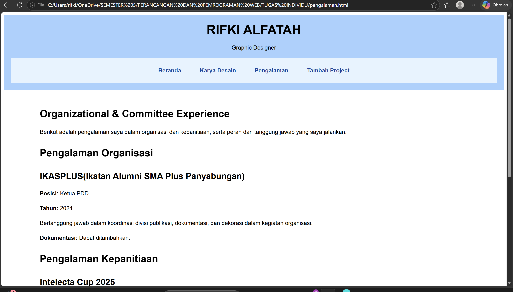

# RIFKI ALFATAH DESIGN

Website portfolio untuk menampilkan hasil karya desain grafis dari kegiatan kepanitiaan dan organisasi, serta pengalaman dalam bidang desain kreatif.

## Fitur Website

- Halaman utama yang memperkenalkan diri dan menampilkan karya desain pilihan.
- Halaman karya desain yang menampilkan koleksi poster dan kategori desain lainnya.
- Halaman pengalaman organisasi dan kepanitiaan.
- Halaman tambah project.
- Formulir tambah desain dan tambah pengalaman.
- Fitur detail karya melalui pop-up.
- Navigasi responsif menggunakan Bootstrap.

## Teknologi yang Digunakan

- HTML5
- CSS3
- Bootstrap 5.3.3
- JavaScript

## Screenshot

### 1. Halaman Utama

### 2. Halaman Karya Desain

### 3. Detail Project

### 4. Halaman Tambah Project

### 5. Isi Form Tambah Project

### 6. Halaman Pengalaman

### 7. Form Tambah Desain

### 8. Form Tambah Pengalaman

### 9. Isi Form Tambah Pengalaman

### 10. Fitur Detail Karya

### 11. form_tambah design

### 12. fitur hide

### 13. filter pencarian 

## Cara Menjalankan Website

1. Clone atau unduh repository ini.
2. Pastikan seluruh file HTML, `style.css`, dan folder `aset/` berada dalam struktur folder yang sesuai.
3. Buka file `tugasindividu.html` menggunakan browser.
4. Gunakan navbar untuk menjelajahi halaman website.

## Pengembang

**Rifki Alfatah**

Website ini dibuat sebagai proyek tugas individu mata kuliah Perancangan dan Pemrograman Web.